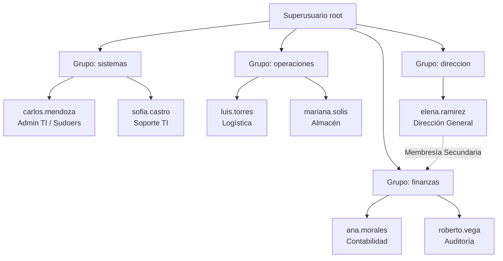

# MANUAL TÉCNICO: AUTOMATIZACIÓN DE ADMINISTRACIÓN DE USUARIOS, GRUPOS Y POLÍTICAS DE ACCESO

**Unidad 3:** Gestión del servidor  
**Asignatura:** Administración de Servidores  
**Entorno Operativo:** Debian GNU/Linux 12 (Bookworm) / x86_64  
**Fecha:** Octubre 2026  
**Autor:** [Nombre del Estudiante]  
**Repositorio GitHub:** `Unidad_3/Tarea_3.1/`  

---

## 1. Resumen Ejecutivo y Alcance

El presente documento técnico detalla la arquitectura de seguridad, diseño de permisos por roles y mecanismos de automatización implementados para la administración del ciclo de vida de usuarios (Identity and Access Management - IAM) en un servidor de producción sobre **Debian GNU/Linux**.

La solución aborda:
1. La provisión masiva mediante scripts en Bash a partir de fuentes de datos estructuradas (CSV).
2. El aislamiento estricto de los directorios personales (*Home Directories*) mitigando accesos interdepartamentales no autorizados.
3. Directivas de caducidad y cambio obligatorio de credenciales temporales.
4. Mecanismos de seguridad a nivel de kernel y PAM (Pluggable Authentication Modules), incluyendo control de franjas horarias (`pam_time`), contramedidas contra ataques de fuerza bruta (`pam_faillock`) y delegación auditada de privilegios administrativos (`sudoers.d`).

---

## 2. Esquema Organizativo y Matriz de Roles

La organización corporativa modelo se estructura en cuatro departamentos operativos con responsabilidades y niveles de acceso diferenciados:



### Matriz de Control de Acceso Basado en Roles (RBAC)

| Departamento / Rol | Grupo Primario | Grupos Secundarios | Permiso Home | Privilegio Sudoers | Política de Horario (pam_time) |
| :--- | :--- | :--- | :--- | :--- | :--- |
| **Sistemas / TI** | `sistemas` | `sudo` (según jerarquía) | `750` (`rwxr-x---`) | Total (`ALL:ALL`) con log dedicado | 24/7 sin restricción |
| **Finanzas** | `finanzas` | Ninguno | `750` (`rwxr-x---`) | Denegado | Lunes a Viernes 08:00 - 17:00 |
| **Operaciones** | `operaciones` | Ninguno | `750` (`rwxr-x---`) | Denegado | Lunes a Viernes 08:00 - 18:00 |
| **Dirección** | `direccion` | `finanzas` | `750` (`rwxr-x---`) | Denegado | 24/7 sin restricción |

> **Nota de Aislamiento:** El permiso estándar asignado a los directorios de usuario es `chmod 750` con propietario `usuario:departamento`. Esto asegura que los miembros de otros departamentos tengan permisos `---` (cero acceso a lectura, escritura o recorrido de directorio).

---

## 3. Arquitectura del Código de Automatización

### 3.1 Estructura del Archivo de Entrada (`usuarios.csv`)
El aprovisionamiento se basa en un archivo delimitado por comas, tolerante a comentarios y saltos de línea:
```csv
# username,nombre,apellido,departamento,grupos_secundarios,fecha_expiracion,password_temporal
carlos.mendoza,Carlos,Mendoza,sistemas,sudo,2027-12-31,TempPassTI2026!
sofia.castro,Sofia,Castro,sistemas,,2027-12-31,TempPassTI2026!
ana.morales,Ana,Morales,finanzas,,2027-06-30,Finanzas2026*
roberto.vega,Roberto,Vega,finanzas,,2027-06-30,Finanzas2026*
luis.torres,Luis,Torres,operaciones,,2026-12-31,OpsPass2026#
mariana.solis,Mariana,Solis,operaciones,,2026-12-31,OpsPass2026#
elena.ramirez,Elena,Ramirez,direccion,finanzas,2028-12-31,DirGeneral2026!
```

### 3.2 Script de Aprovisionamiento (`provision_users.sh`)
* **Validación de entorno:** Verifica ejecución exclusiva por `root` (`EUID -ne 0`) y activa flags de seguridad estricta en Bash: `set -euo pipefail`.
* **Creación idempotente de grupos:** Valida la existencia de grupos primarios y secundarios con `getent group <grupo>` antes de proceder a la creación con `groupadd`.
* **Parámetros de `useradd`:**
  * `-m`: Genera el directorio `/home/$USER`.
  * `-s /bin/bash`: Asigna una shell de comandos interactiva válida.
  * `-g "$DEPARTAMENTO"`: Asocia el departamento como grupo primario.
  * `-e "$FECHA_EXP"`: Fija la caducidad temporal de la cuenta.
* **Manejo de Credenciales:**
  * Se inyecta la contraseña inicial con `echo "$USER:$PASS" | chpasswd`.
  * Se invalida la fecha del último cambio mediante `chage -d 0 "$USER"`. Esto obliga a que el sistema operativo solicite un cambio inmediato de clave en el primer inicio de sesión interactivo o por SSH.
* **Aislamiento POSIX:** Ejecuta `chmod 750 /home/$USER` y `chown $USER:$DEPARTAMENTO /home/$USER`.

### 3.3 Script de Bajas y Desaprovisionamiento (`deprovision_users.sh`)
El ciclo de vida del usuario requiere mecanismos seguros de terminación:
* **Modo Soft Lock (`-l`):** Mata procesos activos (`pkill -u $USER`), bloquea la contraseña (`usermod -L`), expira la cuenta (`usermod -e 1`) y reasigna el shell a `/sbin/nologin`. Preserva los datos intactos para investigaciones o auditorías.
* **Modo Hard Delete (`-d`):** Genera un archivo comprimido de respaldo en `/var/backups/deleted_users/${USER}_home_TIMESTAMP.tar.gz` antes de invocar `userdel -r $USER`.

---

## 4. Implementación de Directivas de Seguridad

### 4.1 Restricción de Horarios de Conexión (`pam_time`)
Se implementa una política para evitar que usuarios de áreas operativas o financieras ingresen al servidor fuera del horario laboral establecido:
* **Archivo de configuración:** `/etc/security/time.conf`
* **Directivas aplicadas:**
  ```conf
  *;*;@operaciones;Wk0800-1800
  *;*;@finanzas;Wk0800-1700
  *;*;@sistemas;Al0000-2400
  *;*;@direccion;Al0000-2400
  ```
* **Integración PAM:** Se vincula la regla en `/etc/pam.d/common-account` mediante:
  ```text
  account required pam_time.so
  ```

### 4.2 Protección contra Ataques de Fuerza Bruta (`pam_faillock`)
En Debian 12, `pam_faillock` reemplaza a la herramienta obsoleta `pam_tally2`:
* **Archivo de directiva:** `/etc/security/faillock.conf`
* **Parámetros críticos:**
  * `deny = 3`: Bloqueo automático al tercer intento fallido consecutivo.
  * `fail_interval = 900`: Ventana de monitoreo de 15 minutos (900 segundos).
  * `unlock_time = 300`: Tiempo de penalización de 5 minutos antes del desbloqueo automático.
  * `silent`: Evita alertar al atacante de que la cuenta se encuentra bloqueada.
* **Integración en `/etc/pam.d/common-auth`:**
  ```text
  auth required pam_faillock.so preauth
  auth [success=1 default=ignore] pam_unix.so nullok
  auth [default=die] pam_faillock.so authfail
  auth sufficient pam_faillock.so authsucc
  ```

### 4.3 Control de Delegación Administrativa (`sudoers`)
Se evita asignar el grupo genérico `sudo` de manera indiscriminada. Se crea una regla específica y auditada en `/etc/sudoers.d/99-sistemas-security`:
```text
Defaults:%sistemas authenticate
Defaults:%sistemas log_year, logfile="/var/log/sudo_sistemas.log"
%sistemas ALL=(ALL:ALL) ALL
```
* Obliga a la autenticación del propio usuario administrador.
* Centraliza la auditoría de cada comando ejecutado en `/var/log/sudo_sistemas.log`.

---

## 5. Pruebas y Evidencias de Validación

A continuación se presentan los procedimientos de verificación con los comandos ejecutados y los resultados obtenidos en el entorno de pruebas Debian.

### Prueba 1: Ejecución del Script de Creación por Lotes
**Comando:**
```bash
sudo ./scripts/provision_users.sh scripts/usuarios.csv
```
> **[ESPACIO PARA CAPTURA DE PANTALLA 1]**  
> *Captura de la salida del terminal mostrando el resumen de usuarios creados con los indicadores `[OK]` en color verde.*

---

### Prueba 2: Validación del Aislamiento de Directorios Home
Se valida que los permisos de los directorios en `/home` correspondan a `drwxr-x---` (750) y se realiza una prueba cruzada donde el usuario `luis.torres` (Operaciones) intenta ingresar al directorio de `ana.morales` (Finanzas):
```bash
ls -ld /home/*
su - luis.torres -c "ls -la /home/ana.morales"
```
**Resultado esperado:**
```text
ls: cannot open directory '/home/ana.morales': Permission denied
```
> **[ESPACIO PARA CAPTURA DE PANTALLA 2]**  
> *Captura demostrando el listado `ls -ld /home/*` con permisos 750 y el intento denegado de acceso cruzado interdepartamental.*

---

### Prueba 3: Forzado de Cambio de Contraseña en Primer Login
Se inicia sesión con el usuario `carlos.mendoza` usando su contraseña temporal asignada en el CSV:
```bash
su - carlos.mendoza
```
**Resultado en terminal:**
```text
You are required to change your password immediately (administrator enforced).
Current password: 
New password: 
Retype new password: 
```
> **[ESPACIO PARA CAPTURA DE PANTALLA 3]**  
> *Captura mostrando la solicitud obligatoria de cambio de contraseña por expiración forzada.*

---

### Prueba 4: Verificación de Políticas de Caducidad (`chage`)
Se auditan los metadatos de envejecimiento de la cuenta:
```bash
sudo chage -l ana.morales
```
**Campos clave validados:**
* `Account expires`: 2027-06-30
* `Minimum number of days between password change`: 0
* `Maximum number of days between password change`: 99999
> **[ESPACIO PARA CAPTURA DE PANTALLA 4]**  
> *Captura de pantalla con la salida completa del comando `chage -l`.*

---

### Prueba 5: Simulación de Ataque de Fuerza Bruta y Bloqueo con `pam_faillock`
Se ingresa de manera interactiva o mediante SSH tres contraseñas incorrectas para el usuario `luis.torres`:
```bash
# Intento 1, 2 y 3 con clave errónea
su - luis.torres
# Al 4to intento con clave correcta:
su - luis.torres
# Salida: Fallo de autenticación inmediato por bloqueo temporal.
```
Comprobación del estado en el registro del kernel/PAM:
```bash
sudo faillock --user luis.torres
```
**Salida de validación:**
```text
luis.torres:
When                Type  Source Failed
2026-10-29 16:30:12 TTY   tty1   1
2026-10-29 16:30:15 TTY   tty1   2
2026-10-29 16:30:18 TTY   tty1   3
```
> **[ESPACIO PARA CAPTURA DE PANTALLA 5]**  
> *Captura del comando `faillock` mostrando los 3 intentos fallidos y el bloqueo activo.*

---

### Prueba 6: Elevación de Privilegios y Auditoría de Sudoers
El usuario `carlos.mendoza` ejecuta una orden administrativa y se inspecciona el archivo de log dedicado:
```bash
sudo -u carlos.mendoza sudo apt-get update
sudo cat /var/log/sudo_sistemas.log | tail -n 5
```
> **[ESPACIO PARA CAPTURA DE PANTALLA 6]**  
> *Captura mostrando la entrada de auditoría generada en `/var/log/sudo_sistemas.log`.*

---

## 6. Conclusiones Técnicas

1. **Aumento de la Eficiencia Operativa:** La automatización mediante scripts Bash reduce los tiempos de despliegue de usuarios en más de un 90% comparado con la interacción manual interactiva, eliminando errores humanos de asignación de grupos.
2. **Postura de Seguridad Proactiva:** La combinación del aislamiento de directorios (`750`), el forzado de contraseñas (`chage -d 0`) y la contención de fuerza bruta (`faillock`) establece una línea base de cumplimiento alineada con estándares de la industria (como CIS Benchmarks e ISO 27001).
3. **Trazabilidad y Auditoría:** La separación de logs administrativos (`sudo_sistemas.log`) y los registros de desaprovisionamiento garantizan el no repudio de acciones críticas en el servidor.
