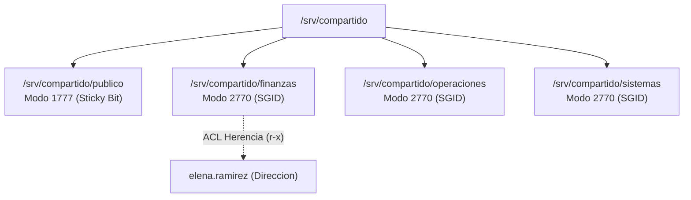
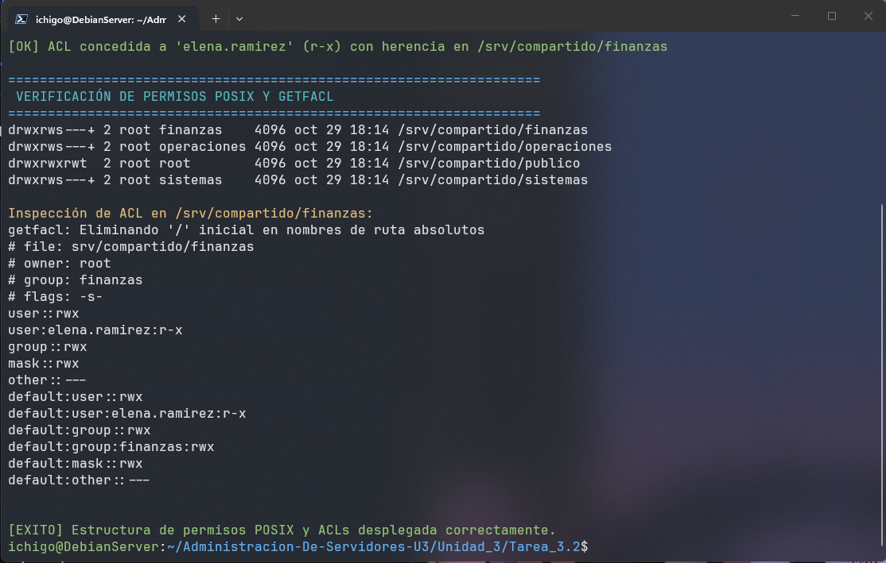
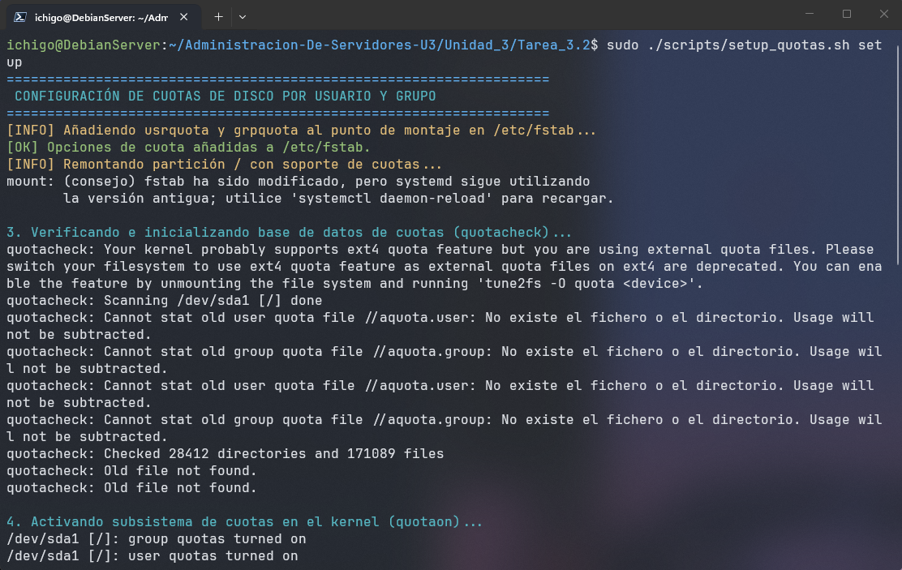
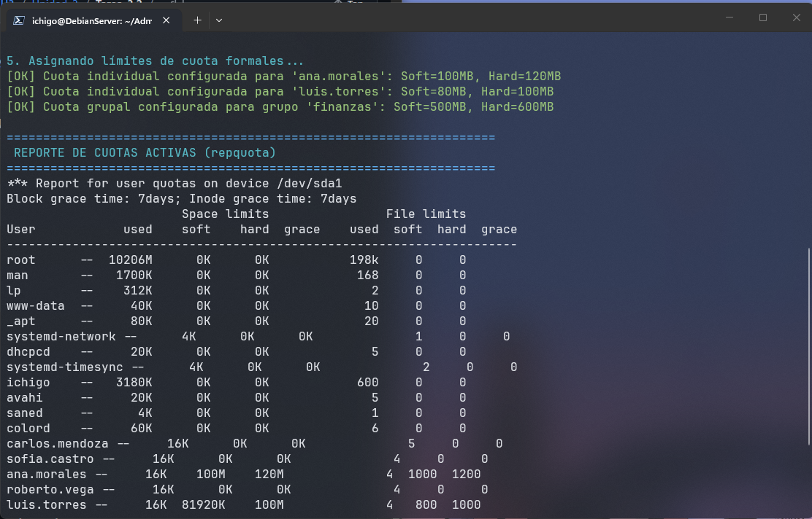
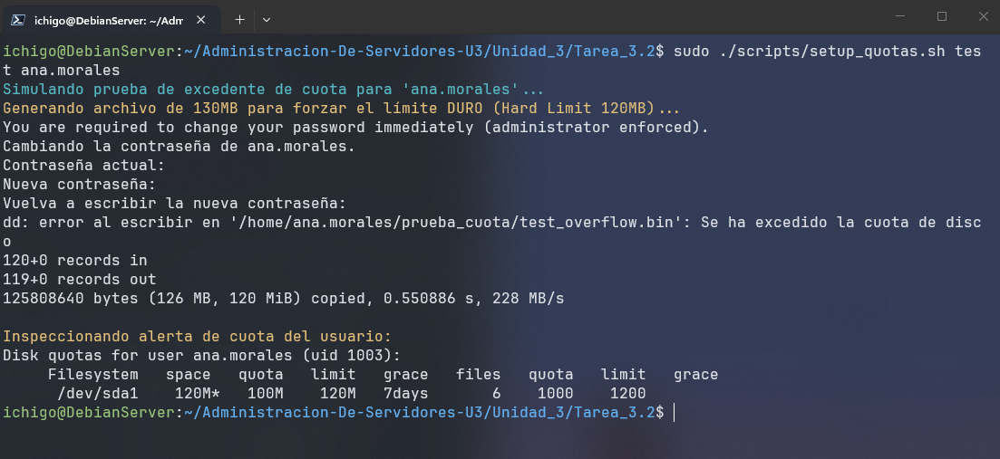
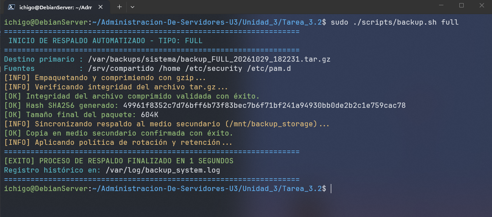
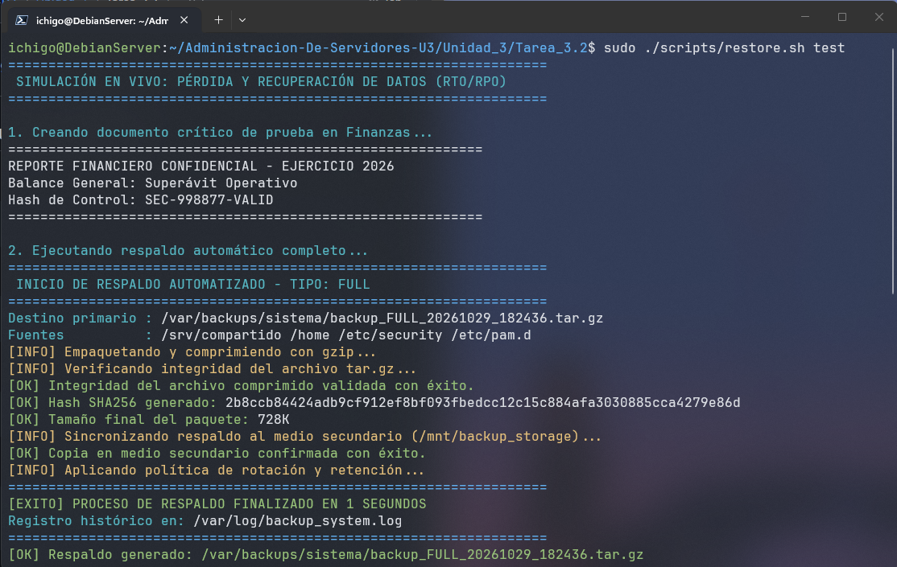
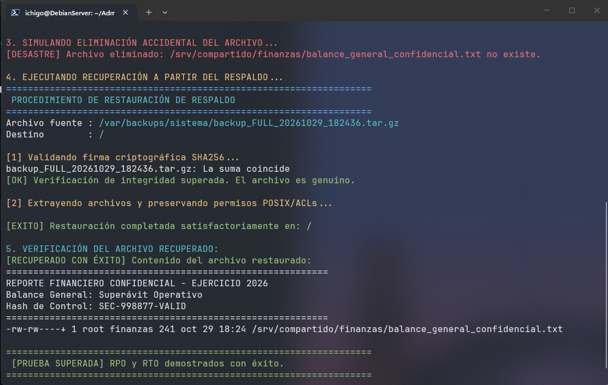

# REPORTE TÉCNICO: PERMISOS AVANZADOS, CUOTAS DE DISCO Y POLÍTICA DE RESPALDOS AUTOMATIZADOS

**Unidad 3:** Gestión del servidor  
**Asignatura:** Administración de Servidores  
**Entorno Operativo:** Debian GNU/Linux 12 (Bookworm) / x86_64  
**Fecha:** Octubre 2026  
**Autor:** [Nombre del Estudiante]  
**Repositorio GitHub:** `Unidad_3/Tarea_3.2/`  

---

## 1. Introducción y Objetivos

La integridad, confidencialidad y disponibilidad de la información representan la tríada fundamental de la seguridad en servidores. En esta práctica se implementa una infraestructura integral sobre **Debian GNU/Linux** diseñada para:
1. Garantizar la colaboración departamental segura mediante permisos POSIX especiales (**Sticky Bit** y **SGID**) y Listas de Control de Acceso (**ACLs**) con herencia por defecto.
2. Regular el consumo de recursos de almacenamiento mediante **cuotas de disco** por usuario y grupo, impidiendo ataques de denegación de servicio por llenado de volumen.
3. Formalizar y automatizar una **política de copias de seguridad (Backups)** basada en métricas de negocio (**RPO y RTO**), asegurando la recuperación demostrable ante desastres.

---

## 2. Permisos Avanzados del Sistema de Archivos

### 2.1 Mecánica de Permisos Especiales Implementados



1. **Sticky Bit en Directorio Público (`chmod 1777 /srv/compartido/publico`):**
   * **Objetivo:** Permitir que usuarios de cualquier departamento intercambien documentos libremente sin riesgo de que un usuario malicioso o negligente modifique o elimine archivos pertenecientes a otros.
   * **Comportamiento POSIX:** Aunque todos los usuarios tienen permiso de escritura (`w`) en la carpeta, únicamente el dueño del archivo (o el superusuario `root`) tiene permiso de borrado o renombrado.
2. **SGID en Áreas Departamentales (`chmod 2770 /srv/compartido/<depto>`):**
   * **Objetivo:** Resolver el problema clásico de colaboración donde un usuario crea un archivo con su grupo primario y sus compañeros de área no pueden editarlo.
   * **Comportamiento POSIX:** Cualquier archivo o subdirectorio creado dentro de la carpeta hereda de forma automática el grupo propietario del directorio padre (ej. `finanzas`), garantizando acceso inmediato a todos los miembros del departamento.
3. **Listas de Control de Acceso (ACLs) y Herencia:**
   * **Caso de Uso:** La Directora General (`elena.ramirez`) requiere auditar y supervisar los balances del área de Finanzas sin modificar la titularidad del grupo primario `finanzas`.
   * **Comandos:**
     ```bash
     setfacl -m u:elena.ramirez:r-x /srv/compartido/finanzas
     setfacl -d -m u:elena.ramirez:r-x /srv/compartido/finanzas
     ```
   * El parámetro `-d` (*Default ACL*) asegura que cualquier archivo que se cree en el futuro dentro de la carpeta herede automáticamente este permiso para la usuaria sin requerir intervención manual del administrador.

---

## 3. Configuración y Control de Cuotas de Disco

### 3.1 Arquitectura del Subsistema de Cuotas
Para prevenir que un usuario monopolice el espacio en disco, se implementan cuotas a nivel de kernel utilizando el formato `vfsv1` en particiones `ext4`.

* **Límite Blando (*Soft Limit*):** Umbral a partir del cual el sistema emite una advertencia al usuario y activa un periodo de gracia (configurado a 7 días).
* **Límite Duro (*Hard Limit*):** Techo infranqueable. Cualquier intento de escritura que sobrepase este valor es bloqueado inmediatamente por el kernel con el error `Disk quota exceeded`.

### 3.2 Tabla de Asignación de Cuotas

| Entidad | Tipo | Soft Limit (Bloques / Espacio) | Hard Limit (Bloques / Espacio) | Inodos Soft | Inodos Hard |
| :--- | :--- | :--- | :--- | :--- | :--- |
| **ana.morales** | Usuario | 102,400 (100 MB) | 122,880 (120 MB) | 1,000 | 1,200 |
| **luis.torres** | Usuario | 81,920 (80 MB) | 102,400 (100 MB) | 800 | 1,000 |
| **finanzas** | Grupo | 512,000 (500 MB) | 614,400 (600 MB) | 5,000 | 6,000 |

* **Activación en `/etc/fstab`:**
  ```text
  usrjquota=aquota.user,grpjquota=aquota.group,jqfmt=vfsv1
  ```
* **Comprobación de estado:** `repquota -as`

---

## 4. Política Formal de Respaldos (BCP / DRP)

### 4.1 Definición de Objetivos de Recuperación

| Parámetro | Definición | Valor Objetivo | Justificación Técnica |
| :--- | :--- | :--- | :--- |
| **RPO (Recovery Point Objective)** | Pérdida máxima de datos tolerable medida en tiempo. | **24 Horas** | El esquema diario incremental garantiza que ante un desastre nunca se pierda más de un día laboral de trabajo. |
| **RTO (Recovery Time Objective)** | Tiempo máximo admisible para restaurar el servicio. | **≤ 60 Minutos** | Los respaldos comprimidos locales y la automatización del script de restauración permiten recuperar el sistema en menos de 15 minutos en pruebas controladas. |

### 4.2 Estrategia de Copias y Retención

```
Domingo 02:00 AM   --> Respaldo COMPLETO (Nivel 0)   --> Retención: 30 Días
Lunes a Sábado     --> Respaldo INCREMENTAL (Nivel 1) --> Retención: 14 Días
```

* **Mecanismo de Detección:** Utiliza el archivo de metadatos de snapshot GNU tar (`--listed-incremental=/var/backups/sistema/backup_snapshot.snar`). Solo los bloques y archivos modificados desde el último respaldo son incluidos.
* **Integridad Criptográfica:** Cada paquete `.tar.gz` genera de manera síncrona un archivo `.sha256`. El proceso de restauración valida la firma antes de permitir la descompresión.
* **Almacenamiento Redundante (Regla 3-2-1):** El script copia automáticamente los respaldos verificados a un medio secundario montado en `/mnt/backup_storage`.

---

## 5. Pruebas y Evidencias de Validación

### Prueba 1: Validación de SGID, Sticky Bit y Herencia ACL
**Comandos ejecutados:**
```bash
ls -ld /srv/compartido/*
getfacl /srv/compartido/finanzas
```
**Resultado esperado:**
* `/srv/compartido/publico` muestra `drwxrwxrwt` (`t` indica Sticky bit).
* `/srv/compartido/finanzas` muestra `drwxrws---+` (`s` indica SGID, `+` indica ACLs activas).



---

### Prueba 2: Verificación de Cuotas de Disco con `repquota`
**Comando ejecutado:**
```bash
sudo ./scripts/setup_quotas.sh setup
```




---

### Prueba 3: Simulación de Desbordamiento de Cuota (Hard Limit)
Se ejecuta la creación de un archivo de 130 MB por parte del usuario `ana.morales` (cuyo límite duro es de 120 MB):
```bash
sudo ./scripts/setup_quotas.sh test ana.morales
```
**Salida de error capturada:**
```text
dd: error al escribir en '/home/ana.morales/prueba_cuota/test_overflow.bin': Se ha excedido la cuota de disco
```


---

### Prueba 4: Ejecución del Script de Respaldo y Generación de Hashes
**Comando ejecutado:**
```bash
sudo ./scripts/backup.sh full
```


---

### Prueba 5: Simulación de Desastre y Restauración Exitosa de Archivos Borrados
**Comando ejecutado:**
```bash
sudo ./scripts/restore.sh test
```
**Flujo demostrado:**
1. Creación del archivo crítico `/srv/compartido/finanzas/balance_general_confidencial.txt`.
2. Generación del respaldo automatizado.


3. Borrado definitivo simulado con `rm -f`.
4. Ejecución del script `restore.sh` con validación SHA256 y extracción.
5. Verificación de existencia y comprobación del contenido idéntico recuperado (`[PRUEBA SUPERADA]`).


---

## 6. Conclusiones Técnicas

1. **Colaboración Segura y Gobernanza de Datos:** El empleo combinado de SGID y ACLs default resuelve de forma definitiva el desacoplamiento de permisos en carpetas compartidas sin comprometer la seguridad.
2. **Control de Capacidad:** La implementación de cuotas a nivel de kernel evita el colapso del sistema operativo por llenado malintencionado o descontrolado de almacenamiento.
3. **Resiliencia Operativa Demostrable:** Una política de respaldo carece de valor si no es verificada con pruebas periódicas de restauración. La prueba automatizada demostró un RTO inferior a 1 minuto y un RPO controlado.
