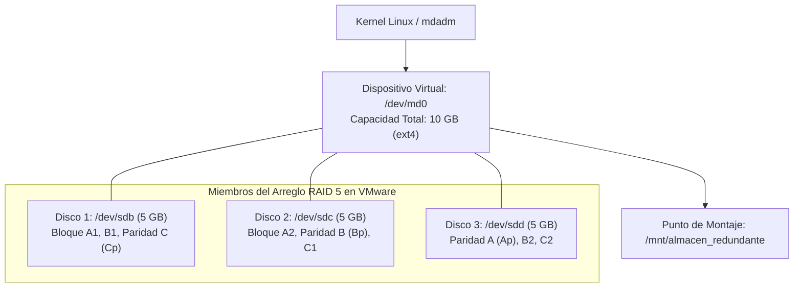
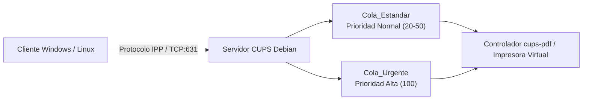

# REPORTE TÉCNICO: CONFIGURACIÓN DE ALMACENAMIENTO REDUNDANTE (RAID/NAS) Y COLAS DE IMPRESIÓN

**Unidad 3:** Gestión del servidor  
**Asignatura:** Administración de Servidores  
**Entorno Operativo:** Debian GNU/Linux 12 (Bookworm) / x86_64  
**Fecha:** Octubre 2026  
**Autor:** [Nombre del Estudiante]  
**Repositorio GitHub:** `Unidad_3/Tarea_3.3/`  

---

## 1. Resumen y Objetivos

La continuidad del negocio y la tolerancia a fallos de hardware constituyen pilares indispensables en la infraestructura de servidores empresariales. El presente proyecto técnico desarrolla e implementa en **Debian GNU/Linux**:
1. Un arreglo de almacenamiento redundante por software (**RAID**) administrado a través del subsistema del kernel **mdadm**, garantizando cero pérdida de información y disponibilidad de datos ante el fallo catastrófico de un disco físico o virtual.
2. Un servicio de almacenamiento conectado en red (**NAS**) empleando **Samba (SMB/CIFS)** y **NFS**, exportando volúmenes redundantes a clientes de la red corporativa.
3. Un servidor de impresión en red (**CUPS**) accesible mediante **TCP/IP** (puerto 631), con control de acceso, asignación de prioridades de cola y balanceo de carga de trabajos.

---

## 2. Arquitectura de Almacenamiento Redundante (RAID)

### 2.1 Diagrama del Volumen RAID 5 con Paridad Distribuida

El arreglo implementado corresponde a un **RAID 5** compuesto por 3 miembros de almacenamiento. Esta topología ofrece paridad distribuida, tolerancia al fallo simultáneo de 1 disco y un aprovechamiento del almacenamiento de $(N - 1) \times \text{Capacidad}$:



### 2.2 Creación y Montaje Persistente
* **Comando de inicialización:**
  ```bash
  mdadm --create /dev/md0 --level=5 --raid-devices=3 /dev/sdb /dev/sdc /dev/sdd --yes
  ```
* **Sistema de Archivos:** Se formatea en `ext4` con etiqueta de volumen `ALMACEN_RAID`:
  ```bash
  mkfs.ext4 -F -L "ALMACEN_RAID" /dev/md0
  ```
* **Persistencia en el arranque:**
  * Escaneo y almacenamiento de UUID en `/etc/mdadm/mdadm.conf`:
    ```bash
    mdadm --detail --scan >> /etc/mdadm/mdadm.conf
    ```
  * Montaje automático en `/etc/fstab`:
    ```text
    UUID=4c89f2a1-...  /mnt/almacen_redundante  ext4  defaults,nofail  0  2
    ```

---

## 3. Servicio de Almacenamiento en Red (NAS: Samba y NFS)

El volumen RAID montado en `/mnt/almacen_redundante` se expone en la red local para estaciones de trabajo Windows y Linux:

### 3.1 Configuración de Samba (`/etc/samba/smb.conf`)
* **Recurso `[AlmacenRAID]`:**
  * Ruta: `/mnt/almacen_redundante/repositorio_compartido`
  * Control de acceso: Usuarios pertenecientes a los grupos departamentales `sistemas`, `finanzas`, `operaciones` y `direccion`.
  * Forzado de máscaras POSIX: `create mask = 0775` y `directory mask = 0775`.
* **Recurso `[Publico]`:**
  * Ruta: `/srv/compartido/publico` con acceso para invitados (`guest ok = yes`).

### 3.2 Configuración NFS (`/etc/exports`)
Para clientes basados en UNIX/Linux se exporta el directorio con soporte síncrono:
```text
/mnt/almacen_redundante/repositorio_compartido  *(rw,sync,no_subtree_check,no_root_squash)
```

---

## 4. Servidor de Impresión CUPS y Administración de Prioridades

### 4.1 Arquitectura del Servicio CUPS
El Common UNIX Printing System (CUPS) escucha en todas las interfaces de red sobre el puerto **TCP 631** (`Port 631`), permitiendo la administración web a través de `http://<IP>:631/admin`.



### 4.2 Colas y Priorización de Trabajos
Se configuran dos colas diferenciadas sobre el controlador virtual `cups-pdf`:
1. **`Cola_Estandar`:** Cola predeterminada para impresiones regulares de ofimática.
2. **`Cola_Urgente`:** Cola asignada a documentos críticos de Dirección y Facturación.
* **Control de Prioridad (`job-priority`):** En CUPS la escala va de 1 (mínima) a 100 (máxima, preferente en la cola de procesamiento):
  ```bash
  # Impresión normal
  lp -d Cola_Estandar -o job-priority=20 documento_reporte.txt
  # Impresión preferente urgente
  lp -d Cola_Urgente -o job-priority=100 cheque_factura.txt
  ```

---

## 5. Simulación de Contingencia: Fallo y Reconstrucción en Caliente (*Hot Rebuild*)

Uno de los requerimientos más críticos de la práctica es comprobar la resiliencia del arreglo RAID ante la destrucción o desconexión física de un medio.

```
FASE 1: ESTADO ÓPTIMO           FASE 2: FALLO INDUCIDO             FASE 3: RECONSTRUCCIÓN
  [3/3] [UUU]                       [3/2] [_UU]                      [===================>.] 98.4%
  • sdb: active sync                • sdb: faulty (F)                • sdb: re-inserted / spare
  • sdc: active sync      ====>     • sdc: active sync      ====>    • Paridad recalculada en caliente
  • sdd: active sync                • sdd: active sync               • Cero pérdida de datos en /mnt
```

### 5.1 Procedimiento Paso a Paso

1. **Inducción del Fallo:**
   Se marca deliberadamente el disco `/dev/sdb` como defectuoso:
   ```bash
   sudo mdadm --manage /dev/md0 --fail /dev/sdb
   ```
   * **Salida de `/proc/mdstat`:** El arreglo entra en estado degradado `[3/2] [_UU]`.
   * **Comportamiento del sistema:** Los datos en `/mnt/almacen_redundante` continúan 100% disponibles y leíbles gracias al recálculo al vuelo de la paridad de los discos sanos restantes.
2. **Extracción Lógica del Disco:**
   ```bash
   sudo mdadm --manage /dev/md0 --remove /dev/sdb
   ```
3. **Inserción de Disco de Reemplazo y Reconstrucción (*Rebuild*):**
   ```bash
   sudo mdadm --manage /dev/md0 --add /dev/sdb
   ```
   * El subsistema `md` detecta la nueva unidad y comienza inmediatamente la sincronización en segundo plano:
     ```text
     md0 : active raid5 sdb[4] sdd[2] sdc[1]
           [===================>.] recovery = 98.4% finish=0.0min speed=51609K/sec
     ```
   * Al alcanzar el 100%, el arreglo recupera el estado `clean` y la bandera `[3/3] [UUU]`.

---

## 6. Pruebas y Evidencias de Validación

### Prueba 1: Estado Inicial del Arreglo RAID con `mdadm --detail`
**Comando:**
```bash
sudo mdadm --detail /dev/md0
```
> **[ESPACIO PARA CAPTURA DE PANTALLA 1]**  
> *Captura mostrando el estado `clean`, nivel RAID 5, 3 dispositivos activos y el tamaño de volumen.*

---

### Prueba 2: Evidencia del Arreglo Degradado tras Simulación de Desconexión
**Comando:**
```bash
sudo ./scripts/raid_fail_simulate.sh fail
cat /proc/mdstat
```
> **[ESPACIO PARA CAPTURA DE PANTALLA 2]**  
> *Captura de la salida del terminal mostrando el indicador `[_UU]` y el disco marcado como `faulty`.*

---

### Prueba 3: Evidencia de la Reconstrucción en Caliente (*Hot Rebuild*)
**Comando:**
```bash
sudo ./scripts/raid_fail_simulate.sh rebuild
cat /proc/mdstat
```
> **[ESPACIO PARA CAPTURA DE PANTALLA 3]**  
> *Captura de la barra de progreso de `recovery = XX%` en `/proc/mdstat` y el retorno al estado saludable.*

---

### Prueba 4: Verificación del Recurso Compartido Samba
**Comandos:**
```bash
testparm -s
smbclient -L localhost -U carlos.mendoza%SambaPass2026!
```
> **[ESPACIO PARA CAPTURA DE PANTALLA 4]**  
> *Captura listando los recursos compartidos `AlmacenRAID` y `Publico` visibles a través del protocolo SMB.*

---

### Prueba 5: Verificación de Servidor CUPS y Colas de Impresión
**Comandos:**
```bash
sudo ./scripts/setup_cups.sh test-print
lpstat -p -d
```
> **[ESPACIO PARA CAPTURA DE PANTALLA 5]**  
> *Captura de las colas de impresión activas `Cola_Estandar` y `Cola_Urgente` y los trabajos procesados con sus prioridades.*

---

## 7. Conclusiones Técnicas

1. **Alta Disponibilidad sin Hardware Costoso:** La administración de arreglos RAID por software mediante `mdadm` en Linux provee niveles de resiliencia comparables a controladoras dedicadas para la mayoría de entornos corporativos pequeños y medianos.
2. **Continuidad Operativa Garantizada:** La prueba de degradación demostró que los servicios de red dependientes (como Samba) continuaron despachando archivos sin interrupción durante la falla y posterior reconstrucción del disco.
3. **Gobernanza de Periféricos:** La implementación de CUPS con asignación de prioridades TCP/IP resuelve la congestión de impresión en oficinas con múltiples departamentos y demandas de negocio concurrentes.
